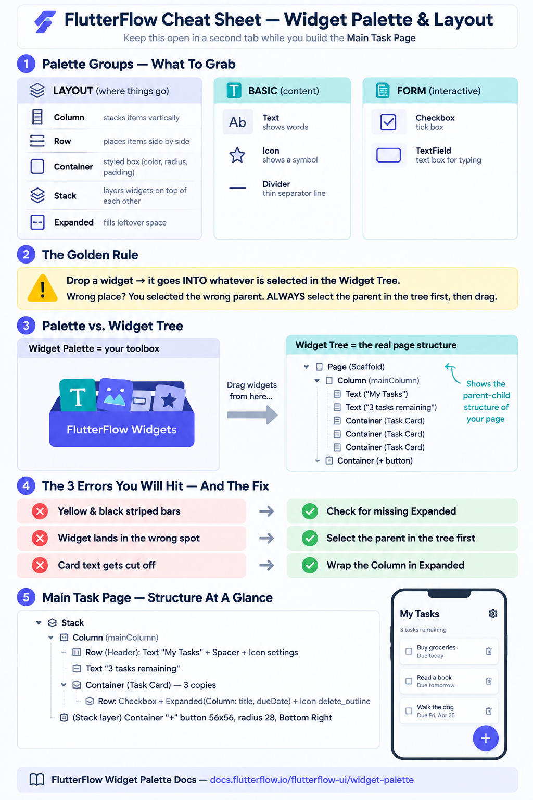

# FlutterFlow Tutorial: Build Your Main Task Page (Front-End Only)

**For:** Complete beginners to FlutterFlow (no coding required)
**Reference:** https://docs.flutterflow.io/flutterflow-ui/widget-palette
**Time needed:** 45–60 minutes

## 📌 Start Here
Keep the **cheat sheet** open in a second browser tab while you build:

## What You Will Learn
- Use widgets from the Widget Palette
- Build a responsive page layout without code
- Spot and fix the most common beginner layout error

## Before You Start
- FlutterFlow account (free plan)
- Chrome or Edge browser
- About 1 hour
(No coding tools, no database, no GitHub needed.)

## 1. Create Your Project
1. Log in to FlutterFlow
2. Create New Project
3. Name: task-tracker-student
4. Choose the Blank template
5. Skip Firebase for now

## 2. The Widget Palette
Left panel of the builder. Groups:
- Layout Elements: Column, Row, Container, Stack, Expanded
- Basic Elements: Text, Icon, Divider
- Form Elements: Checkbox, TextField

Golden Rule: select the parent in the Widget Tree before dragging.

## 3. Build the Main Task Page

### Stage 1: Create the page
- Page Selector -> + Add Page -> name it MainTaskPage
- Set Initial Page in Settings -> App Details
- Turn AppBar OFF

### Stage 2: Page base
- Drag a Column
- Set: Main Axis Size = max, Cross Axis Alignment = stretch, Padding = 16, Background = surface color
- Rename to mainColumn

### Stage 3: Header
- Row inside mainColumn
- Text "My Tasks" (size 28, bold)
- Spacer
- Icon: settings
- 16px bottom padding

### Stage 4: Counter
- Text "3 tasks remaining" (grey, size 14)

### Stage 5: Task card
- Drag a Container into mainColumn
  - Padding 12, Margin bottom 8, Border Radius 12, card color
- Row inside the Container:
  - Checkbox
  - Expanded -> Column -> two Text widgets (title bold 16; date grey 13)
  - Icon: delete_outline

### Stage 6: Copy the card twice
- Right-click the card Container -> Copy -> Paste twice
- Rename the text: Finish report, Call dentist
- Tick the checkbox on the third card

### Stage 7: Floating + button
- Drag a Stack as the outermost widget
- Put mainColumn inside it
- Add a Container: Width 56, Height 56, Border Radius 28, primary color, Bottom Right, margin 24
- Icon "add" inside, white color

## 4. Polish
- Keep 16px page padding consistent
- Muted grey icons (#6B7280)
- Only titles bold
- Pick a theme in Theme Settings

## 5. Preview on a Phone
- Click Preview, switch to phone size
- Check header, all three cards, and the + button
- Try tablet size too
- No yellow/black overflow bars

## 6. Common Problems
- Red/yellow bars: check for missing Expanded
- Widget drops in wrong place: select the parent in the tree first
- + button not floating: Stack must contain mainColumn
- Text cut off: wrap the Column in Expanded
- Empty page in preview: check Initial Page
- Uneven card spacing: set margin to 0 top, 8 bottom
- Checkbox does nothing: expected in a front-end build

## 7. Final Checklist
- [ ] MainTaskPage is the Initial Page
- [ ] Header shows title and settings icon
- [ ] "3 tasks remaining" line appears
- [ ] Three task cards with checkbox, title, date, delete icon
- [ ] One card ticked as completed
- [ ] Floating + button at bottom-right
- [ ] No overflow bars on phone or tablet
- [ ] One consistent color theme

## 8. Bonus Challenges
1. Add a 4th task
2. Add a divider
3. Try an empty state
4. Add a date picker
5. Styling pass
